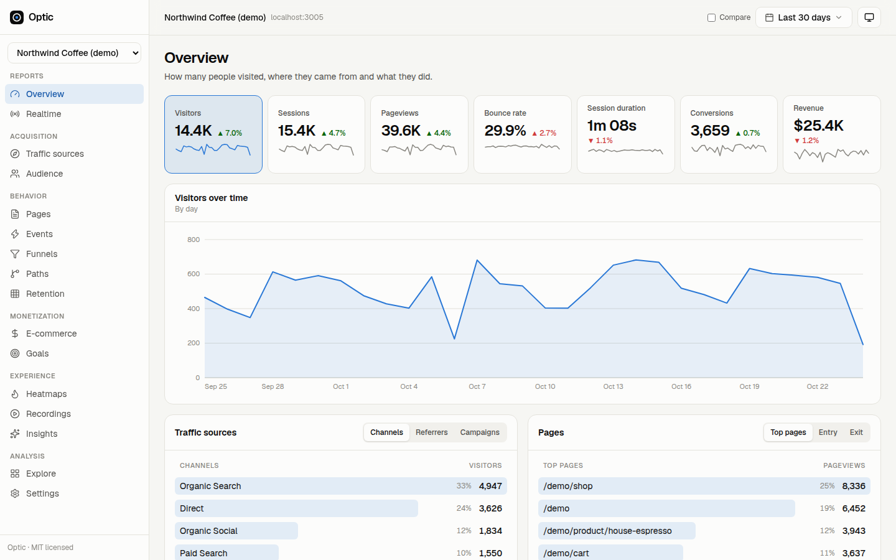
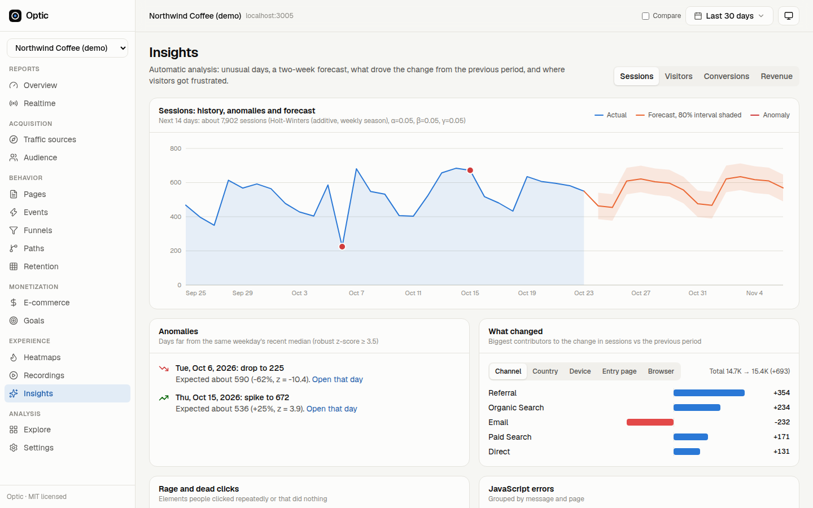
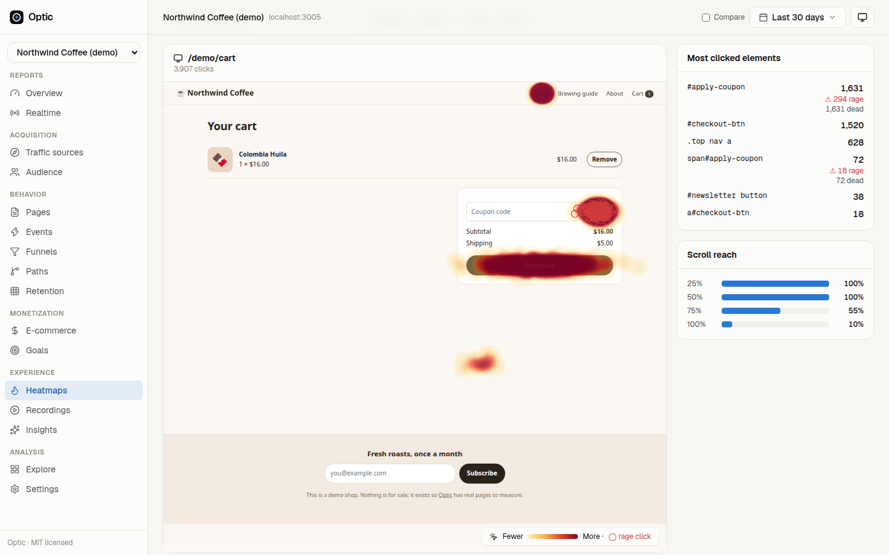
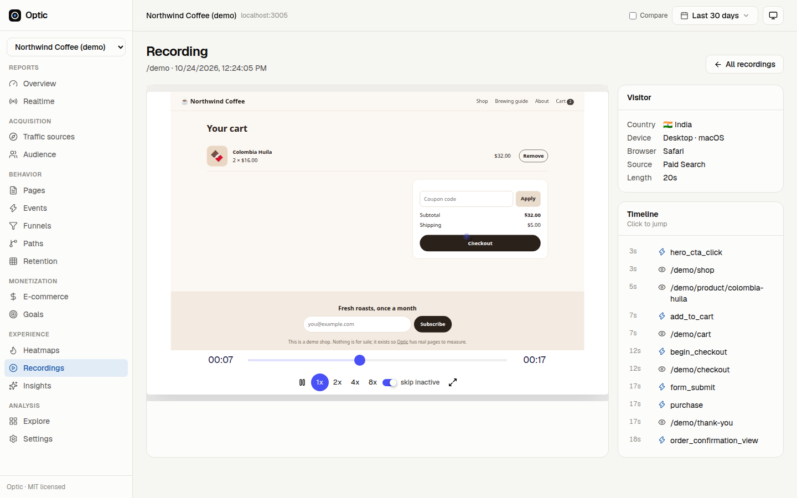
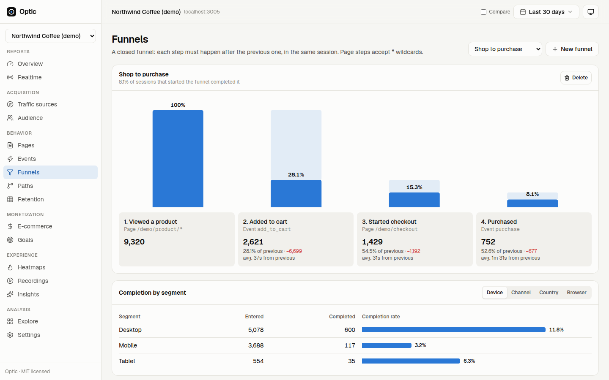
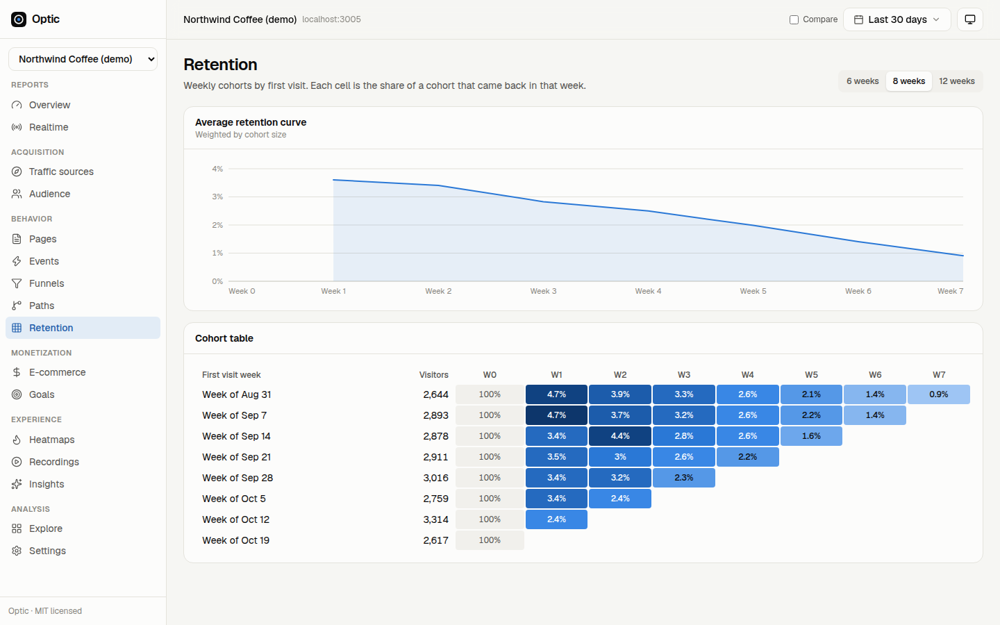
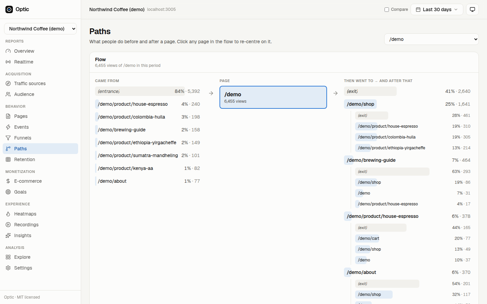
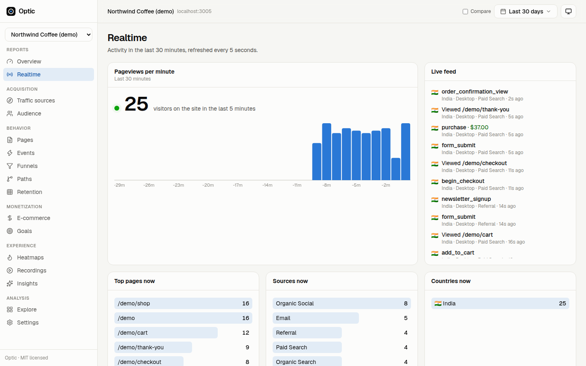
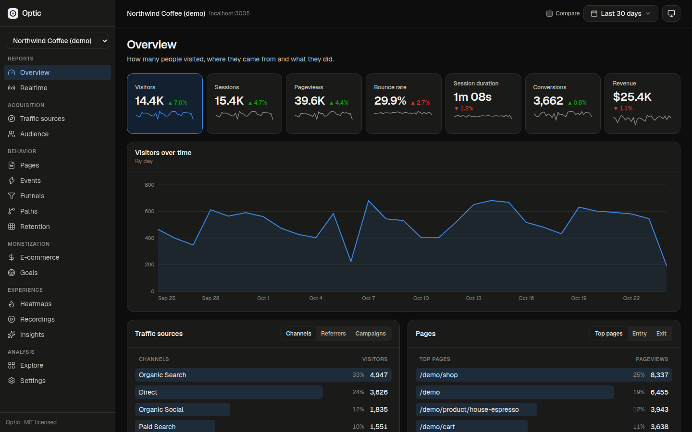
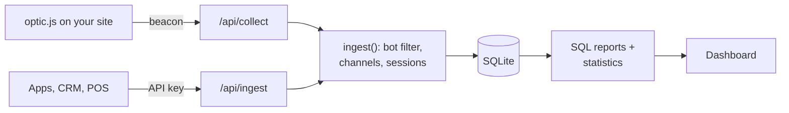

<div align="center">


# Optic

**Open-source, self-hosted web analytics. GA4-style reports, Clarity-style heatmaps and session replays, and forecasting, in one Next.js app.**

[](LICENSE)
[](https://github.com/amanjhacodes55/optic/actions/workflows/ci.yml)
[](https://nextjs.org)
[](https://www.sqlite.org)
[](https://www.typescriptlang.org)

[**Watch the demo video**](docs/media/optic-demo.mp4) · [Quick start](#quick-start) · [Docs](#documentation)

</div>

[](docs/media/optic-demo.mp4)

Google Analytics 4 is powerful but sends your visitors' data to Google and needs a cookie banner. Microsoft Clarity has
great heatmaps and replays but no real reporting. Optic does both on your own server: one script on your site, one
SQLite file for storage, no third parties, and free to use, change and redistribute under the MIT License.

## Features

The five capabilities modern analytics platforms are built around, all included:

**1. Data collection and integration**
- One 6 KB script. Single-page apps (React, Next.js, Vue) are tracked automatically through the History API.
- [Server ingest API](docs/api.md#server-side-ingestion) for mobile apps, back ends, CRMs and point-of-sale systems,
  with backdated events and cross-device identity (`optic("identify", userId)`).
- **No-code tag manager**: turn CSS-selector clicks, form submits and page rules into events, or load third-party
  scripts only after consent, without editing the site.
- **Privacy first**: cookieless by default (a daily-rotating salted hash), consent modes for the EU/UK, optional Do Not Track and
  Global Privacy Control support, query strings never stored, inputs masked in replays.

**2. Traffic and audience**
- GA4's default channel grouping from UTM tags, click ids and referrers.
- Segments by country, language, device, browser, OS, screen, platform, new vs returning.
- Realtime view, refreshed every 5 seconds.
- Click any row in any report to filter the whole dashboard; filters live in the URL, so views are shareable.

**3. Behaviour**
- Automatic events: outbound clicks, file downloads, form submits, video plays, JavaScript errors, Web Vitals.
- **Closed funnels** with drop-off, time between steps and a split by device, channel, country or browser.
- **Path exploration** before and after any page, and the most common journeys.
- **Weekly retention cohorts** with a weighted average curve.

**4. Conversions and e-commerce**
- Event and page goals with values.
- Revenue, orders, average order value, cart and checkout abandonment, products, revenue by channel.

**5. Automation and reporting**
- **Anomaly detection** with a weekday-aware median baseline and robust (MAD) z-scores.
- **Forecasting** with Holt-Winters (level + trend + weekly season), fitted per site, with an 80% interval.
- **What changed**: which channels, countries, devices or pages drove the change from the previous period.
- **Explore**: a custom report builder (up to 3 dimensions × 8 metrics) with CSV export for notebooks and spreadsheets.

**Plus, like Microsoft Clarity**
- **Click and scroll heatmaps** drawn over the live page, for desktop and mobile.
- **Session recordings** with [rrweb](https://github.com/rrweb-io/rrweb) and a clickable event timeline.
- **Rage clicks, dead clicks and JavaScript errors**, linked to the heatmap and the recordings.
- **Core Web Vitals** (LCP, INP, CLS, FCP, TTFB) at the 75th percentile, per page.

## Screenshots

<table>
  <tr>
    <td width="50%"><br /><sub><b>Insights</b>: anomalies, a 14-day forecast and what drove the change</sub></td>
    <td width="50%"><br /><sub><b>Heatmaps</b>: rage clicks ringed on a broken coupon button</sub></td>
  </tr>
  <tr>
    <td><br /><sub><b>Session recordings</b>: replay with a jump-to timeline</sub></td>
    <td><br /><sub><b>Funnels</b>: closed funnel with completion by segment</sub></td>
  </tr>
  <tr>
    <td><br /><sub><b>Retention</b>: weekly cohorts</sub></td>
    <td><br /><sub><b>Paths</b>: where people go before and after a page</sub></td>
  </tr>
  <tr>
    <td><br /><sub><b>Realtime</b>: live visitors and event feed</sub></td>
    <td><br /><sub><b>Dark mode</b>: its own validated palette</sub></td>
  </tr>
</table>

<sub>The data shown is generated demo traffic for a fictional coffee shop.</sub>

## Quick start

**Try it locally with demo data (Node.js 20.9+):**

```bash
git clone https://github.com/amanjhacodes55/optic.git
cd optic
npm install
npm run seed      # four months of demo traffic for the Northwind Coffee shop (about 20 s)
npm run dev
```

Open <http://localhost:3000>. The demo dashboard opens without an account; **create an account** to add your own
sites (each account sees only its own sites, plus the read-only demo). Browse the tracked
demo shop at <http://localhost:3000/demo> and watch yourself appear in **Realtime**; your visit is also recorded under
**Recordings**. `npm run demo:bots` sends a few scripted visitors through the shop to create more replays.

**Run it for real with Docker:**

```bash
docker compose up -d   # then open http://your-server:3000 and create your account
```

Then add your site in the dashboard and paste the snippet into your pages:

```html
<script defer src="https://analytics.example.com/optic.js" data-site="YOUR_SITE_ID"></script>
```

See [self-hosting](docs/self-hosting.md) for reverse proxies, country headers, backups and every environment variable.

## Documentation

| Guide | What's in it |
| --- | --- |
| [Tracker](docs/tracker.md) | Install, what is collected, the JavaScript API, e-commerce events, no-code events, privacy controls |
| [HTTP API](docs/api.md) | Collect, server-side ingest and every reporting endpoint |
| [Metric definitions](docs/metrics.md) | Exactly how visitors, sessions, bounce rate, channels, funnels, cohorts, anomalies and forecasts are computed |
| [Architecture](docs/architecture.md) | Ingestion, storage, indexes, query design, performance numbers |
| [Self-hosting](docs/self-hosting.md) | Docker, Node.js, environment variables, proxies, backups |

## How it works



- **Next.js 16** (App Router, route handlers, `proxy.ts`) serves the tracker, the API and the dashboard.
- **Accounts**: email and password (scrypt), database-backed sessions, per-account sites, and a public read-only demo.
- **SQLite** through libSQL stores everything in one WAL-mode file, or in a hosted [Turso](https://turso.tech) database
  on serverless hosts such as Netlify (set `TURSO_DATABASE_URL`). Session-level counters mean most reports
  read one row per session. On 55,000 demo sessions and 656,000 events, every report returns in under 350 ms.
- **Reports are plain SQL**: CTE chains for funnels, `LAG`/`LEAD` window functions for paths, first-visit cohorts.
- **Statistics are dependency-free TypeScript** ([`src/lib/stats.ts`](src/lib/stats.ts)), unit tested.
- **Charts are hand-written SVG** with a colour-blind-safe palette and separate dark-mode colours.

## Development

```bash
npm run dev          # dev server on :3000
npm test             # vitest: channel rules, UA parsing, statistics, and end-to-end SQL over real ingestion
npm run lint
npm run typecheck
npm run build
```

| Script | Purpose |
| --- | --- |
| `npm run seed` | Generate demo traffic through the real ingestion path (`SEED_DAYS`, `SEED_RESET=1`) |
| `npm run demo:bots` | Drive headless Chrome through the demo shop to record real sessions (`BOTS`, `BOTS_LOOP=1`) |
| `npm run demo:layout` | Re-capture the demo shop's element positions used to place seeded clicks |

Project layout:

```
public/optic.js          the tracker
public/demo/             Northwind Coffee, the tracked demo shop
src/lib/ingest.ts        validation, sessionisation, writes
src/lib/query/           report SQL, insights
src/lib/stats.ts         anomaly detection, Holt-Winters, contributions
src/app/api/             collect, replay, ingest, config, stats, sites, auth
src/app/dashboard/       the dashboard pages
scripts/                 seed, bots, layout capture, Docker entrypoint
tests/                   vitest suites
```

Contributions are welcome; see [CONTRIBUTING.md](CONTRIBUTING.md). Report security issues privately as described in
[SECURITY.md](SECURITY.md).

## License

[MIT](LICENSE) © 2026 Aman Jha. Use it for anything, commercial or not; just keep the copyright notice.

Optic bundles [rrweb](https://github.com/rrweb-io/rrweb) (MIT) for session recording and replay. The demo video's
voice-over was generated with [Kokoro](https://huggingface.co/hexgrad/Kokoro-82M) (Apache-2.0) through
[kokoro-js](https://www.npmjs.com/package/kokoro-js).
