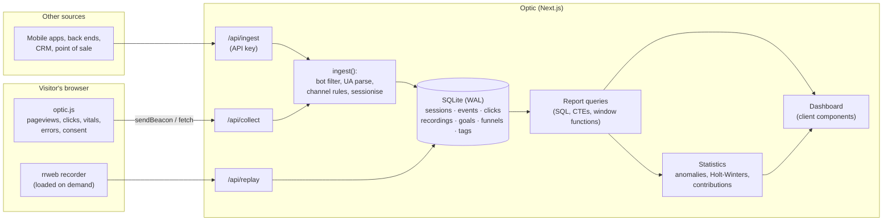

# Architecture

Optic is one Next.js 16 application. The same process serves the tracker, receives events, stores them in SQLite and
renders the dashboard.

## Ingestion

1. The tracker batches events and sends them as `text/plain` JSON (no CORS preflight), with `sendBeacon` when the page
   is hidden so the last events are not lost.
2. [`/api/collect`](../src/app/api/collect/route.ts) drops bots, rate-limits per IP and validates the payload with zod.
3. [`ingest()`](../src/lib/ingest.ts) runs each batch in one transaction. It hashes the visitor id, finds the
   visitor's open session (last activity within 30 minutes) or creates one with the entry page, referrer, UTM tags,
   channel, country and device, then writes events and updates the session's counters.
4. Session-level counters (pageviews, engaged time, conversions, revenue) are kept on the session row, so most reports
   read one row per session instead of scanning every event.

Session replay chunks are gzipped and stored as blobs, keyed by a per-page-load recording id and linked to the
session the pageview opened.

## Storage

SQLite in WAL mode: many concurrent readers and one writer, which suits analytics (tiny writes, heavy reads). The whole
dataset is one file, easy to back up and to inspect with any SQLite tool. Indexes:

| Index | Serves |
| --- | --- |
| `sessions(site_id, started_at)` | Every report's date range |
| `sessions(site_id, visitor_id, last_seen)` | Finding a visitor's open session on every event |
| `events(site_id, ts)`, `events(session_id, ts)`, `events(site_id, name, ts)` | Event reports, funnels, paths |
| `clicks(site_id, path, ts)` | Heatmaps |

The session lookups pin the visitor index with `INDEXED BY`. Without it, SQLite's planner sometimes picks the time
index for `started_at < ?` and scans almost the whole table, which made the demo seed 27× slower.

Measured on the demo dataset (55,000 sessions, 656,000 events, a laptop): every report returns in under 350 ms, and
seeding 120 days of traffic through the real ingestion path takes about 17 s.

## Queries

[`src/lib/query/context.ts`](../src/lib/query/context.ts) turns the URL (site, dates in the site's time zone, filters)
into a parameterised `WHERE` clause shared by every report. Dimension names come from a fixed allow-list; values are
always bound parameters. Notable queries:

- **Funnels**: a chain of CTEs, one per step, each joining the previous step's first-match time.
- **Paths**: `LAG`/`LEAD` over each session's pageviews.
- **Cohorts**: each session tagged with its visitor's first-visit week via a correlated `MIN()` on the visitor index.
- **Explore**: a safe pivot, grouping by up to three allow-listed dimensions.

## Dashboard

Pages under `/dashboard/[site]` are client components that read their state (date range, filters, comparison) from
the URL, so every view is shareable and the back button undoes a filter. Charts are hand-written SVG
([`components/charts.tsx`](../src/components/charts.tsx)) using a categorical palette validated for colour-vision
deficiency, with separate dark-mode steps.

**Accounts and access.** Users sign up with email and password (hashed with scrypt). A session is a random 256-bit
token in an HttpOnly cookie; only its SHA-256 is stored in `auth_sessions`, so a copy of the database cannot be used to
sign in. Every site has an owner; [`access.ts`](../src/lib/access.ts) lets owners view and change their sites and lets
anyone view sites marked public (the bundled demo), read-only, without its API key. `proxy.ts` (Next 16's replacement
for middleware) only redirects signed-out visitors away from account pages; each API route checks access itself. The
tracker endpoints check nothing but the site id, and `/api/ingest` checks the site's API key.

## Demo data

[`scripts/seed.ts`](../scripts/seed.ts) generates four months of traffic through the real `ingest()` function: weekly
seasonality, growth, a channel mix, devices, countries, returning visitors, a purchase funnel, and three planted
events for the anomaly detector to find (an email campaign, a tracking outage and a Product Hunt launch). Clicks land
on the real positions of the demo shop's elements, captured with headless Chrome by
[`scripts/capture-layout.ts`](../scripts/capture-layout.ts). [`scripts/bots.ts`](../scripts/bots.ts) drives real
browsers through the shop to record genuine session replays.
